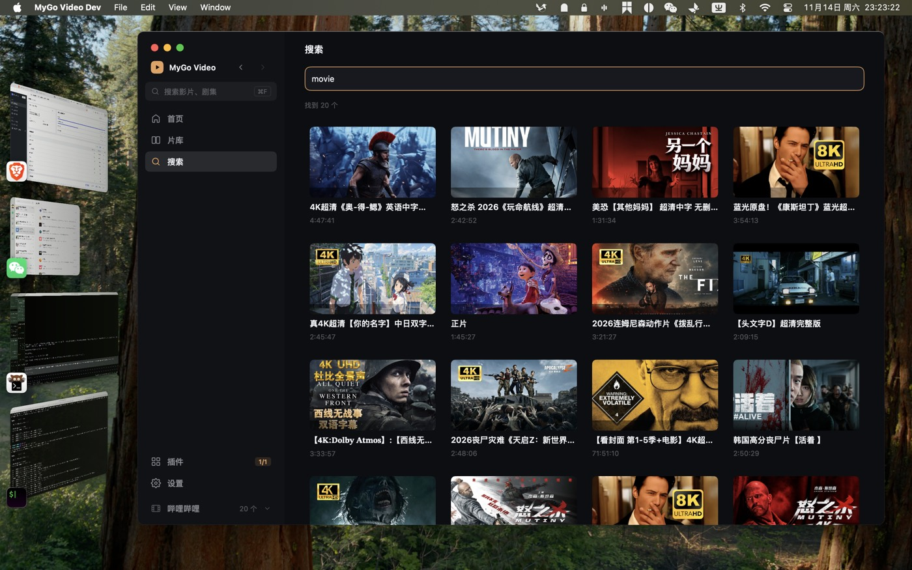
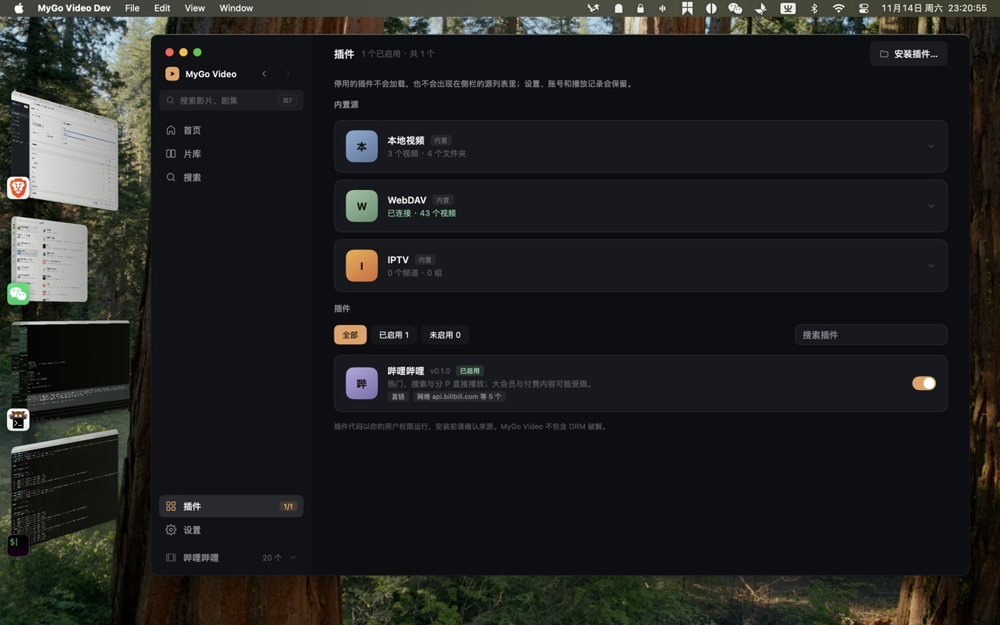
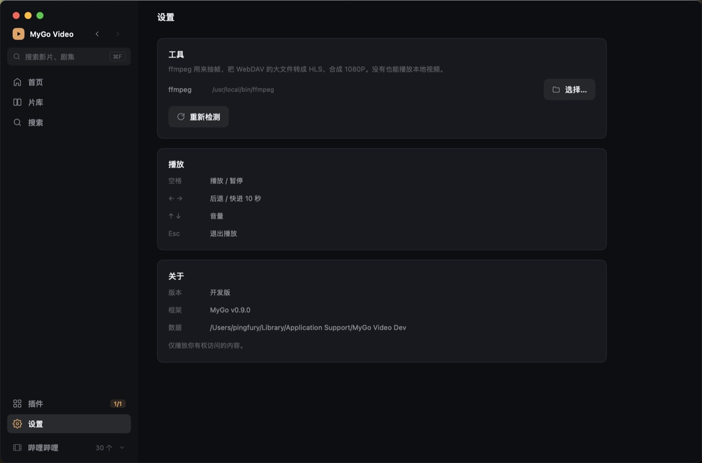

# MyGo Video

[](https://github.com/pingfury108/mygo-video/actions/workflows/build.yml)
[](https://github.com/pingfury108/mygo-video/releases/latest)


用 Go 和 [MyGo](https://github.com/egoist/mygo) 写的原生桌面视频播放器。界面由 MyGo 在 GPU 上绘制，视频交给系统的媒体框架硬解（macOS AVFoundation、Windows Media Foundation、Linux GStreamer）。

本地库、WebDAV、IPTV，以及一个能接入视频站点的插件系统——B 站插件支持热门、搜索、追番选集、收藏、历史、稍后再看、1080P DASH、弹幕，以及**直播和直播弹幕**；腾讯视频与优酷提供浏览与搜索，正片在官方页面播放（`playback: catalog`）。



## 功能

**本地与内置源**

- 扫描 `~/Movies`、桌面、下载和应用数据目录下的 `videos/`，识别 `S02E05`、`1x05`、`第05集` 这样的集数
- 同名的剧集自动折叠成一张卡，详情页选集，播放页 `,` `.` 切上一集/下一集
- WebDAV：浏览文件夹、Basic Auth、播放走本机代理；moov 在尾部的 MP4 自动转 HLS，边转边播
- IPTV：M3U/M3U8 列表，按分组浏览直播频道

**播放器**

- 系统解码、进度条拖动、音量、10 秒快进/后退、续播、倍速（会记住）、全屏
- 一集播完自动接下一集
- 字幕：自动加载同名的 `.srt` / `.vtt` / `.ass`；没有外挂文件时用 ffmpeg 取内嵌的第一条轨
- 弹幕：插件提供的点播弹幕（滚动 + 顶/底固定）和直播弹幕
- 清晰度：插件可提供 1080P DASH，由代理合成 HLS

**插件**

- 独立「插件」页：插件市场、文件夹 / zip / GitHub 安装、启用、停用、设置、账号、卸载
- 官方插件随 Release 发布：CI 把 `examples/*` 打成 zip，并生成 `plugins.json`；应用里的「插件市场」直接列出、安装和更新
- 插件默认停用；停用会关掉 JS 运行时和网络访问，数据保留
- 插件只产出数据，界面全部由 app 绘制



**搜索与详情**

- 搜索文件名、剧名、集数，`⌘F` 聚焦
- 插件来源的搜索走各自的接口（B 站用 wbi 签名）
- 详情页有海报、简介、选集、进度、清除记录

**自动更新**

- 启动 10 秒后检查 GitHub Releases，之后每天一次；有新版时显示更新说明
- 可以安装、稍后提醒或跳过这个版本；装完重启生效
- 只下改动过的部分（delta），失败时回退整包
- 设置 → 关于 里可以随时手动检查

## 截图

<p>
  
</p>

## 安装

### 下载

在 [Releases](https://github.com/pingfury108/mygo-video/releases/latest) 下载最新版本，包内含对应架构的 ffmpeg：

| 平台 | 文件 |
| --- | --- |
| macOS Apple Silicon | `mygo-video-<版本>-darwin-arm64.zip` |
| macOS Intel | `mygo-video-<版本>-darwin-amd64.zip` |
| Windows x64 | `mygo-video-<版本>-windows-amd64.zip` |
| Linux x64 | `mygo-video-<版本>-linux-amd64.zip` |

推一个 `v*` 标签就会触发构建并自动建 Release；README 之后的所有提交也在同一次运行里校验。

### 本地构建

```bash
go tool mygo dev      # 开发运行，改 .go 自动重启
go tool mygo build    # 打包到 build/
```

需要 Go（见 `go.mod`）和 [Bun](https://bun.sh)（`mygo.config.ts` 由它求值）。不需要 cgo。

## ffmpeg

这些能力需要 ffmpeg：

- 本地/WebDAV 视频的封面抽帧
- WebDAV 里 moov 在尾部的 MP4 转 HLS
- B 站 1080P 的 DASH 双流合成 HLS
- WebDAV 的时长探测（`ffmpeg -i` 输出里的 `Duration:`）

查找顺序：

1. 设置 → 工具里选的路径
2. 应用自带的 `resources/bin/`（打包版内嵌）
3. `PATH`，以及 Homebrew / MacPorts / 发行版的常见目录

没有 ffmpeg 时仍能播放本地视频、IPTV 和 B 站 720P，只是没有缩略图、WebDAV 大文件播不了、1080P 降到 720P。设置 → 工具会显示找到了哪个，也可以手动选。

## 内置源

内置源和插件一起在侧栏的「插件」页管理：本地视频、WebDAV、IPTV 三张卡，点开就能配置。

**WebDAV**：填地址（含路径，如 `https://nas.local:5005/dav`）、用户名和密码。列表和索引会缓存在本地，重启后先用上次的结果。

**IPTV**：填 M3U/M3U8 的地址或本地路径，保存后按 `group-title` 分组。

## 开发插件

插件是一个文件夹，里面是 `plugin.json` 和一个 JS/TS 模块：

```
plugins/<id>/
  plugin.json
  index.js
```

### plugin.json

```json
{
  "id": "bilibili",
  "name": "哔哩哔哩",
  "version": "0.1.0",
  "description": "热门、搜索、分 P 与直播。",
  "apiVersion": 1,
  "main": "index.js",
  "playback": "stream",
  "permissions": { "network": ["api.bilibili.com", "*.bilivideo.com"] },
  "settings": [{ "key": "cookie", "label": "Cookie", "help": "手动填的登录信息" }],
  "login": {
    "url": "https://passport.bilibili.com/login",
    "cookieHosts": ["bilibili.com"]
  }
}
```

| 字段 | 说明 |
| --- | --- |
| `id` | 唯一标识，也是数据目录名 |
| `name` / `version` / `description` | 插件页显示 |
| `apiVersion` | 目前是 `1` |
| `main` | 入口文件，相对路径 |
| `playback` | `stream`（直接播）或 `catalog`（目录，正片在官方页播） |
| `permissions.network` | `fetch`、WebSocket 和 `host.openURL` 能访问的 host，支持 `*.example.com` 和 `*` |
| `permissions.streamHosts` | 允许交给播放器的直链 host；不填时沿用 `network`。需要 CDN 与 API 不同域时再单独声明 |
| `settings` | 设置项，插件页自动生成输入框 |
| `login` | 登录页地址，以及登录后要保存哪些域的 Cookie |

### 导出函数

模块导出什么，插件就有什么能力。缺失的导出不会出现在界面上（比如没有 `live` 就没有直播 tab）。

| 导出 | 参数 | 返回 |
| --- | --- | --- |
| `home` | | `{title, sections: [{title, videos: [...]}]}` |
| `browse` | `{page}` | 同上 |
| `search` | `{query, offset}` | `{videos, more}` |
| `title` | `{id}` | `{video, episodes}` |
| `play` | `{id, quality}` | 见下 |
| `history` / `favorites` / `following` / `watchLater` | | 同 `home` |
| `live` | | 同 `home`，卡片带 LIVE |
| `liveDanmaku` | `{id}` | 启动直播弹幕后返回 |
| `stopLive` | | 停止直播弹幕 |
| `danmaku` | `{id}` | `{cues: [{time, text, color, mode}]}` |
| `progress` | `{id, position, duration, done}` | 上报进度 |
| `account` / `signIn` / `signOut` | | 账号 |

`videos` 的字段：

```js
{
  id: "BV1xx",          // play 收到的 id
  name: "标题",
  poster: "https://...", // 受网络权限限制
  overview: "简介",
  duration: 120000,      // 毫秒
  series: "剧名",        // 可选，用于分组
  season: 1, episode: 2, // 可选
  live: false            // 直播卡片
}
```

`play` 的返回：

```js
// 直接给流，走本机代理
{ url, type: "mp4" | "hls", headers: { Referer, "User-Agent", Cookie }, duration }

// DASH：画面和声音分开，代理合成 HLS
{ type: "dash", dash: { video, audio }, headers, quality: "1080P" }

// 让系统浏览器打开
{ open: "https://www.bilibili.com/video/BV1xx" }

// 明确拒绝
{ drm: "widevine" }
```

`play.type == "flv"` 也会被代理转成 HLS（直播用）。

### host API

插件里可以用的全局对象：

| 调用 | 说明 |
| --- | --- |
| `fetch(url, options)` | 标准 fetch，受 `permissions.network` 限制 |
| `host.setting(key)` | 读设置项 |
| `host.storage.get/set/remove(key)` | 插件自己的持久化，JSON |
| `host.cookie()` | app 为这个插件保存的 Cookie 头 |
| `host.emitDanmaku({text, color})` | 把一条直播弹幕交给播放器 |
| `host.ws.open(url, headers)` / `host.ws.on` / `host.ws.send` / `host.ws.close` | WebSocket（受网络权限限制） |
| `host.inflate(bytes)` | zlib 解压 |
| `host.crypto.md5(text)` | MD5（B 站 wbi 签名用） |
| `host.openURL(url)` | 用系统浏览器打开（受网络权限限制） |
| `host.platform` / `host.arch` / `host.dir` / `host.dataDir` | 运行环境 |
| `host.ffmpeg` | 是否有 ffmpeg，用来决定要不要请求 DASH |

`setTimeout` / `setInterval`、`TextEncoder`、`TextDecoder`、`TypedArray`、`ArrayBuffer` 都可用。

### 登录

插件在 `login` 里声明登录页和要保存 Cookie 的域：

```json
"login": { "url": "https://passport.bilibili.com/login", "cookieHosts": ["bilibili.com"] }
```

插件页点「登录」后：

1. app 在内嵌 WebView 里打开这个页面，用户在官方页面里扫码或登录
2. 点「我已完成登录」，app 只挑 `cookieHosts` 匹配的域，写进 `plugin-data/<id>/cookies.json`（0600）
3. 之后插件用 `host.cookie()` 拿到这个 Cookie 头，自己放进请求
4. 「退出登录」会删掉这份 Cookie 并调插件的 `signOut`

app 不接触密码，也不把 Cookie 给别的插件。

### 生命周期与调试

```
安装            → 默认停用
插件页打开开关   → plugin.Load：编译 JS
第一次调用       → 启动 VM
停用            → Close：关 VM、断网络；设置和账号保留
调用超时        → 30 秒；无响应判卡死，重启运行时
```

- 开发时把插件放进数据目录的 `plugins/<id>/`，在插件页启用即可
- 改了代码，点插件页的「重新加载」
- 发版前把 `plugin.json` 里的 `version` 加一，插件市场据此提示更新
- 运行日志看 `diag.log`（数据目录下）和 `go tool mygo dev` 的终端
- `host.ffmpeg` 告诉插件有没有 ffmpeg，可以据此降级（B 站就降到了 720P）

完整示例见 [`examples/bilibili-plugin`](examples/bilibili-plugin)：热门、搜索、分 P、追番选集、收藏、历史、直播、弹幕、登录、1080P。另有 [`examples/youku-plugin`](examples/youku-plugin)（搜索 + 打开官方页）和 [`examples/tencent-plugin`](examples/tencent-plugin)（`playback: catalog`，用 `getPage` 读首页与频道的剧集，播放交给官方专辑页）。

## 数据目录

macOS（开发版）：

```
~/Library/Application Support/MyGo Video Dev/
  state.json          进度、音量、源选择、插件开关、工具路径
  webdav-cache.json   WebDAV 目录与索引缓存
  thumbs/             封面帧
  plugins/<id>/       插件
  plugin-data/<id>/   插件的设置、storage、cookies.json
  diag.log            诊断日志
```

正式版把 `MyGo Video Dev` 换成 `MyGo Video`。

Windows 上默认在 `%APPDATA%\MyGo Video`。想放到别的盘：设置 → 关于 → 更改…，选一个目录，app 会问要不要把现有数据一起移过去，然后重启。选择记在这个目录的 `data-dir.txt` 里，下次启动就换过去；「恢复默认」删掉这个文件即可。Windows 会把数据、缓存、日志和临时文件都放在这个目录下（`cache/`、`logs/`、`tmp/`），播放和 WebView2 也不再写系统的 `%LOCALAPPDATA%`。

## 项目结构

```
main.go
internal/
  app/          视图与状态：侧栏、首页、详情、播放、搜索、插件页、设置
  local/        本地库：扫描、文件名解析
  media/        领域模型：视频、进度、时长
  plugin/       JS/TS 宿主：manifest、moejs、host API、WebSocket
  store/        进度、音量、源选择、插件状态（JSON）
  subtitle/     SRT / VTT 解析
  thumb/        ffmpeg 抽帧
  ffbin/        查找 ffmpeg（设置 / 自带 / PATH）
  streamproxy/  本机代理：请求头注入、HLS 重写、AES-128、DASH/FLV 转 HLS
  webdav/       PROPFIND、Basic Auth
  iptv/         M3U/M3U8 解析
examples/
  bilibili-plugin/
  youku-plugin/
  tencent-plugin/
docs/
  PLAN.md        架构与里程碑
  PLUGIN-API.md  插件协议
  screens/       README 的截图
designs/         可交互的界面设计稿
```

## 开发

```bash
go test ./...                                  # 单元测试
SHOTS=/tmp/shots go test ./internal/app -run TestShots   # 渲染各页面成 PNG
NETWORK=1 go test ./internal/plugin -run TestBilibili     # 打真实接口（需要 BILI_COOKIE）
```

设计稿：

```bash
open designs/mygo-video/index.html
```

## 已知限制

- 官方插件市场只列出本仓库随 Release 发布的插件；第三方插件仍没有签名校验，安装前请确认来源
- 封面是正片里的一帧，不是刮削来的海报；没有 ffmpeg 时回退到首字色块
- 字幕只取文本：ASS/SSA 的位置与样式不还原，内嵌的只取第一条轨
- B 站直播弹幕用轮询（官方 WebSocket 拒绝非官方客户端），延迟约 2 秒
- 自动更新只对安装版有效；用 deb/rpm 装的由包管理器负责更新
- 更新包带签名校验，换机器或手改安装目录后可能只能整包更新
- 腾讯视频的搜索接口要签名，插件只把搜索交给官方页面；浏览用的是它自己的 `getPage`
- 受 DRM 保护的内容无法播放，这是有意为之
- 只播放你有权访问的内容

## License

代码是 MIT，见 [LICENSE](LICENSE)。发行包里内嵌的 ffmpeg 是独立的程序（各平台都是 GPL 构建，含 x264 转码器），它的许可与来源见 [THIRD-PARTY-NOTICES.md](THIRD-PARTY-NOTICES.md)。

## 下一步

见 [docs/PLAN.md](docs/PLAN.md)。近期方向：腾讯/优酷的 L2 目录适配、弹幕样式设置、第三方插件源。
